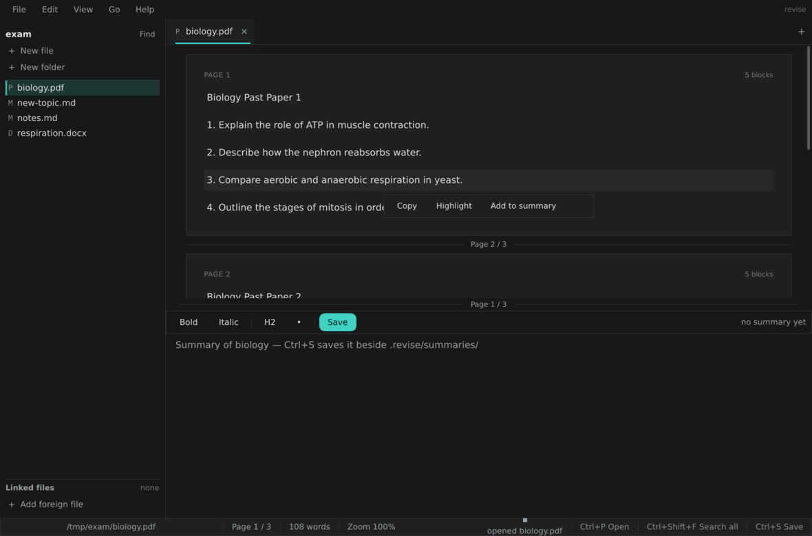

# revise

A keyboard-first desktop app for revising from a folder of exam material: read a
PDF or DOCX on top, keep your own summary underneath it, search everything in
the folder (and anything you link to it) and highlight the parts that matter.

Zig + [nanoui](https://github.com/ojilon/zigui) for the window; Python does all
file-format work and owns the SQLite database. Nothing is parsed in Zig.



## What it does

- **Read** a PDF as flowing text pages with a thin `Page n / N` ruler between
  pages, or a DOCX as paragraphs in their real styles (headings, bullets).
- **Summarise**: the bottom pane is a plain-text editor with light markers. For
  a DOCX or PDF it writes a summary named `<name>-summary.docx`; for a `.md` or
  `.txt` file the editor is the file itself.
- **Search** the folder and every linked file with Ctrl+Shift+F: results grouped
  by file, page or line number, the matched word highlighted, Enter opens the
  file at that place.
- **Highlight** a block, and it stays highlighted (in the database, never inside
  the PDF).
- **Link** a file from anywhere else on disk into the folder with "Add foreign
  file"; it then shows up in the sidebar and in search.

## Setting up

Zig 0.17.0 and Python 3.11+ are needed. The window library is a sibling
checkout, because `build.zig.zon` refers to it by path:

```
git clone --depth 1 https://github.com/ojilon/zigui ../zigui
python -m venv .venv
.venv/bin/pip install -r requirements.txt      # Windows: .venv\Scripts\pip
zig build
```

Run it on a folder of material (no argument means the current directory):

```
./zig-out/bin/revise            # Linux
zig-out\bin\revise.exe C:\exam  # Windows
```

If the Python interpreter is not found automatically, point at it:
`REVISE_PYTHON=C:\exam\.venv\Scripts\python.exe`. The order is `REVISE_PYTHON`,
then `.venv` in the folder being opened, then `python`, then `py`.

Tests:

```
zig build test
.venv/bin/python -m unittest discover -s tools/tests -t tools/tests
```

A Windows cross-build only checks that it compiles: `zig build -Dtarget=x86_64-windows-gnu`.

## Keyboard

| Key | What it does |
| --- | --- |
| Ctrl+P | quick open (fuzzy, folder + linked files) |
| Ctrl+Shift+F | search all files |
| Ctrl+G | go to page |
| Ctrl+S | save the summary (or the text file) |
| Ctrl+N / Ctrl+Shift+N | new file / new folder |
| Ctrl+O | open another folder |
| Ctrl+B / Ctrl+I | bold / italic around the selection |
| Ctrl+Tab / Ctrl+Shift+Tab | next / previous tab |
| Ctrl+W | close tab |
| Ctrl+= / Ctrl+- / Ctrl+0 | zoom in / out / 100% |
| Ctrl+wheel | zoom the reader |
| Ctrl+Shift+D | light / dark theme |
| Ctrl+R | reindex the folder, now |
| PgUp / PgDn, Home / End | move through the reader |
| Esc | close the overlay, clear the selection |
| Ctrl+Q | quit |

Everything above is also in the menu bar (File, Edit, View, Go, Help).

## How it is put together

`src/main.zig` parses the arguments, builds the `App` and opens the window.
`app.zig` owns the state and draws the frame: menu bar, sidebar, tab strip, the
split of reader and editor, status bar, and the overlays on top. Each of those is
one module — `menu_bar.zig`, `sidebar.zig`, `tabs.zig`, `reader_pane.zig`,
`editor_pane.zig`, `statusbar.zig`, `overlays.zig` — and `theme.zig` holds the two
palettes. The parts that are worth testing are pure: `paths.zig` (extensions,
cache keys, `-summary.docx` naming), `model.zig` (the JSON the tools emit),
`markers.zig` (`# `, `- `, `**bold**`), `fsops.zig` (the folder listing) and
`pybridge.zig` (starting a child process and reading its JSON without blocking).
Every Python call is a child process polled once per frame, so the window never
waits: the status bar says `working…` until the JSON arrives. Extractions are
cached under `.revise/cache/<sha1 of path>.json`, so a 300-page PDF is read once
and pages are drawn only within ±2 of the page being read.

## The save protocol

No code path writes a source file except `tools/save_docx.py`, in this order:

1. Compare the size, mtime and sha256 of the file with the values recorded when
   it was extracted. If they differ, write nothing and return
   `{"conflict": true}`; the app shows **Overwrite / Save a copy / Cancel**.
2. Copy the original to `.revise/backups/<name>.<timestamp>.docx`.
3. Write the new document to a temporary file next to the original, extract that
   temporary file again, and check its paragraph texts equal the ones being
   saved. If not, keep the original and return `{"error": "verify failed"}`.
4. Only then replace the original atomically and record the new size, mtime and
   sha256.

PDFs are never written; their highlights live in the database. `tools/db.py`
owns `.revise/revise.db` (SQLite with FTS5, falling back to `LIKE`), holding
`links`, `files`, `fts` and `highlights`.

More detail — file list, decisions, what is unfinished — is in [NOTES.md](NOTES.md).
